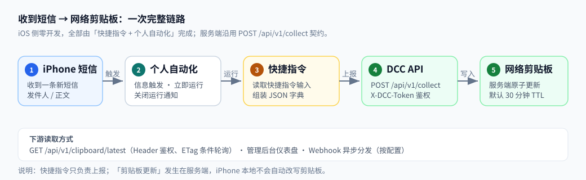
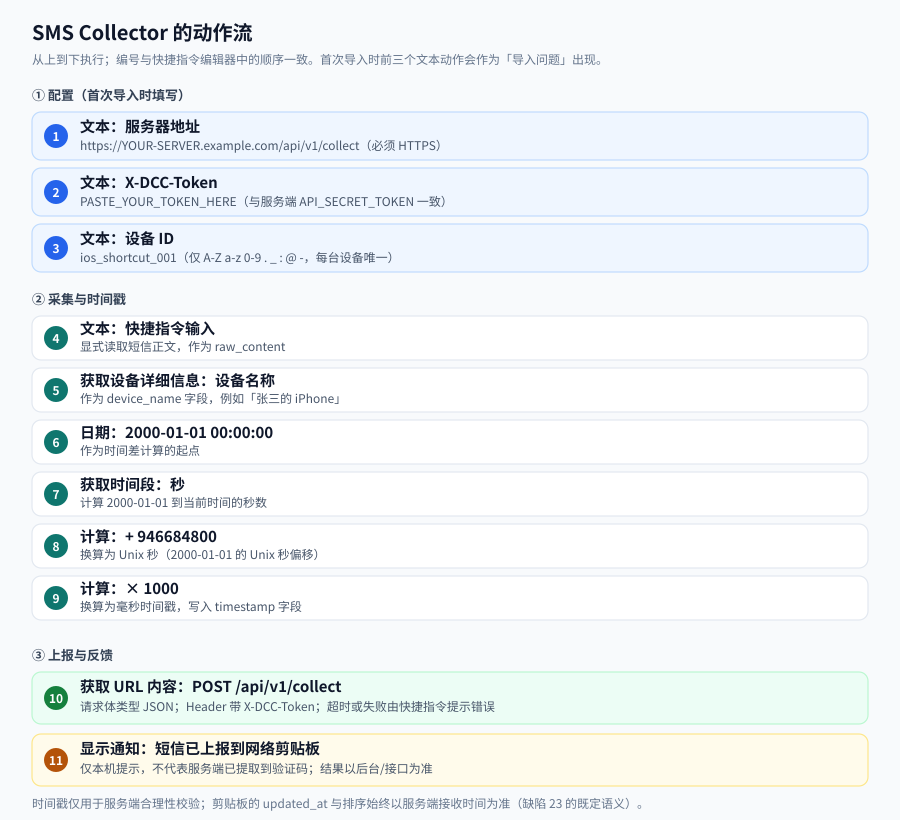
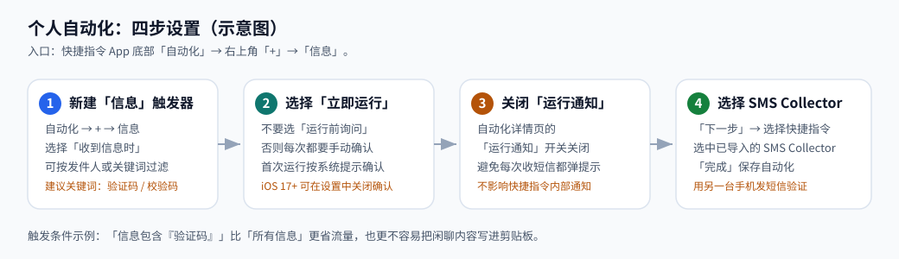

# iOS 快捷指令接入包与图文教程

本目录交付 **REQ-202610-1267【iOS】快捷指令接入包与图文教程**：iOS 侧零开发接入，用「快捷指令 + 个人自动化」把收到的短信上报到 DCC 网络剪贴板。



## 交付物

| 文件 | 用途 |
| --- | --- |
| `sms-collector.shortcut` | **导入包**（二进制 plist）。在 iPhone 上直接导入快捷指令 App。 |
| `sms-collector.source.plist` | 同一份快捷指令的 XML 源文件，便于代码审阅、diff 与重新生成；**不要**把它当导入包。 |
| `scriptable/sms-collector.js` | 可选的 Scriptable 适配脚本（§3），适合需要精确毫秒时间戳或更清晰错误提示的场景。 |
| `examples/sample-payload.json` | 与快捷指令完全一致的请求体样例，可用于 curl 联调。 |
| `images/*.svg` | 本教程使用的示意图。 |
| `README.md` | 本教程。 |

## 0. 一分钟了解链路

```text
iPhone 收到短信
  → 个人自动化（信息触发、立即运行、关闭运行通知）
  → SMS Collector 快捷指令（读取「快捷指令输入」→ 组装 JSON 字典）
  → POST /api/v1/collect（Header: X-DCC-Token）
  → 服务端更新网络剪贴板（默认 TTL 30 分钟）
  → 后台仪表盘 / GET /api/v1/clipboard/latest / Webhook 下游读取
```

快捷指令只负责**上报**；「剪贴板更新」发生在服务端，iPhone 本地剪贴板不会被自动改写。

## 1. 前置条件

1. **服务端已部署**并启用 `POST /api/v1/collect`（依赖 REQ-202610-1253）。
2. 已配置服务端环境变量 `API_SECRET_TOKEN`（为空时所有采集请求都会 401）。
3. 服务端地址必须是 **HTTPS**。快捷指令的「获取 URL 内容」在 iOS 上默认要求安全传输；生产环境还应由部署层强制 HTTPS。
4. iPhone 安装「快捷指令」App（iOS 15 及以上；本包在 iOS 16/17/18 的兼容性说明见第 8 节故障排查）。
5. 准备一个**每台设备唯一**的 `device_id`，例如 `ios_shortcut_001`、`ios_zhangsan_iphone`。只允许字母、数字与 `. _ : @ -`，长度 1–128。

先用 curl 确认服务端可用：

```sh
export SERVER='https://your-server.example.com'
export TOKEN='your-api-secret-token'

curl -i "$SERVER/api/v1/health"
curl -i -X POST "$SERVER/api/v1/collect" \
  -H 'Content-Type: application/json' \
  -H "X-DCC-Token: $TOKEN" \
  --data-binary @examples/sample-payload.json
```

预期采集响应（HTTP 200）：

```json
{
  "code": 200,
  "message": "Data collected successfully",
  "data": {
    "collection_id": "col_1760000000000123456",
    "extracted_code": "839201",
    "clipboard_updated": true
  }
}
```

如果这里不通，先解决服务端问题，再继续 iOS 侧。

## 2. 导入并配置快捷指令

### 2.1 导入

1. 用 AirDrop、文件 App、邮件或 iCloud 云盘把 `sms-collector.shortcut` 传到 iPhone。
2. 点击文件 → 「添加快捷指令」。如果系统提示「无法打开快捷指令」或「不受信任的快捷指令」：
   - 打开 **设置 → 快捷指令 → 允许不受信任的快捷指令**（不同 iOS 版本名称略有差异）。
   - 如果看不到该开关，先在「快捷指令」App 里手动运行任意一个快捷指令，再回到设置查看。
   - 本包是**未签名**的快捷指令文件（仓库内无法调用 Apple 的签名服务）；只从本仓库导入，不要从陌生来源导入。
3. 导入时会弹出三个「导入问题」，分别填写：

| 占位符 | 填写内容 |
| --- | --- |
| `https://YOUR-SERVER.example.com/api/v1/collect` | 你的服务端 **collect 接口完整地址**，必须 HTTPS，并以 `/api/v1/collect` 结尾 |
| `PASTE_YOUR_TOKEN_HERE` | 与服务端 `API_SECRET_TOKEN` 一致的令牌 |
| `ios_shortcut_001` | 本机唯一的设备 ID（只允许 `A-Z a-z 0-9 . _ : @ -`） |

如果导入时没有出现提问（旧版 iOS 或分享方式不同），打开快捷指令，编辑最上面的三个「文本」动作，把三个占位符分别替换掉即可。动作流见下图：



### 2.2 手动试跑

快捷指令使用「快捷指令输入」作为 `raw_content`。从 App 里直接点运行通常没有输入，容易得到 400 `raw_content must be a non-empty string.`。推荐用下面任一方式试跑：

- **方式 A（推荐）**：新建一个临时快捷指令，放一个「文本」动作写入样例短信，再放一个「运行快捷指令」动作，选择 `SMS Collector`，把文本作为输入传入。
- **方式 B**：在任意文本 App 中选中一段文字，通过分享菜单运行 `SMS Collector`。
- **方式 C**：直接给自己发一条短信，按第 3 节配置好个人自动化后做真机验收。

试跑成功时，iPhone 会收到「短信已上报到网络剪贴板」的本地通知。注意：这个通知只代表快捷指令执行到了最后一步，**不代表服务端一定提取到了验证码**；以服务端响应、后台日志或剪贴板查询为准。

## 3. 创建个人自动化（核心步骤）



1. 打开「快捷指令」App → 底部「自动化」→ 右上角「+」。
2. 选择「**信息**」触发器 → 「**收到信息时**」。
   - **发件人**：先选「任何发件人」；确认链路通了以后，再按需要限定银行/服务号。
   - **信息包含**（可选）：建议填「验证码」或「校验码」，减少把闲聊内容写进剪贴板。注意不同银行的文案差异，过滤太窄会漏采集。
3. 选择「**立即运行**」，不要选「运行前询问」。如果 iOS 首次仍弹出确认，按提示允许一次。
4. 关闭「**运行通知**」（即取消“运行时通知我”），避免每收一条短信就弹一次自动化提示。
5. 点「下一步」→ 选择 `SMS Collector` → 「完成」。
6. 用另一台手机给这台 iPhone 发一条测试短信（内容包含「验证码 839201」之类）。观察：
   - 服务端日志出现 `collect.received` → `collect.extracted` → `collect.clipboard_updated` → `collect.responded`；
   - 后台仪表盘/日志看板出现这条记录；
   - 若已部署 REQ-202610-1256，`GET /api/v1/clipboard/latest` 返回这条短信。

> 多 SIM 说明：iOS 的信息自动化不区分 SIM 卡；如果两张卡都会收验证码，服务端会按 `device_id` 归到同一台设备。需要区分时，为不同用途建两个自动化/两个快捷指令，使用不同的 `device_id`。

## 4. 动作流与 JSON 结构

### 4.1 动作流

| # | 动作 | 作用 |
| --- | --- | --- |
| 1 | 文本：服务器地址 | 存放 collect 接口 URL（导入问题 1） |
| 2 | 文本：X-DCC-Token | 存放令牌（导入问题 2） |
| 3 | 文本：设备 ID | 存放 `device_id`（导入问题 3） |
| 4 | 文本：快捷指令输入 | 显式获取短信正文，作为 `raw_content` |
| 5 | 获取设备详细信息：设备名称 | 取 `Device Name` 作为 `device_name` |
| 6 | 日期：2000-01-01 00:00:00 | 时间差计算起点 |
| 7 | 获取时间段：秒 | 计算起点到当前时间的秒数 |
| 8 | 计算：+ 946684800 | 换算为 Unix 秒 |
| 9 | 计算：× 1000 | 换算为毫秒时间戳 |
| 10 | 获取 URL 内容 | `POST` + JSON 请求体 + `X-DCC-Token` Header |
| 11 | 显示通知 | 本机提示上报完成 |

> 时间戳为什么这样算：iOS 快捷指令没有直接的 `Date.now()` 文本函数。第 5–8 步用「2000-01-01 到当前时间」的秒数加上 2000-01-01 的 Unix 秒偏移，再乘 1000，得到毫秒整数。设备时区可能带来小时级偏差，但服务端只把 `timestamp` 用于合理性校验；`updated_at` 与排序始终以服务端接收时间为准（缺陷 23 的既定语义）。

### 4.2 请求体

```json
{
  "device_id": "ios_shortcut_001",
  "device_name": "iPhone",
  "platform": "ios",
  "sender": "",
  "raw_content": "【示例银行】您的验证码是 839201，5 分钟内有效。请勿告诉他人。",
  "timestamp": 1760000000000
}
```

| 字段 | 必填 | 约束 | 说明 |
| --- | --- | --- | --- |
| `device_id` | 是 | 1–128 字符，`A-Za-z0-9._:@-` | 每台设备唯一，用于设备列表与统计 |
| `device_name` | 是 | 非空，≤128 字符 | 快捷指令取 `Device Name` |
| `platform` | 是 | `android` / `ios` | 固定 `ios` |
| `sender` | 否 | ≤64 字符；可为空字符串 | iOS 自动化通常拿不到发件人，默认留空（见第 5 节） |
| `raw_content` | 是 | 非空，≤ `MAX_RAW_CONTENT_LENGTH`（默认 4096） | 短信正文，来自「快捷指令输入」 |
| `timestamp` | 是 | 整数 epoch 毫秒，≥ 2000-01-01 且 ≤ 服务端 +24h | 仅做合理性校验 |

未知字段会被忽略；服务端成功写入剪贴板后返回 `clipboard_updated: true`，并异步触发 Webhook（若已配置）。

## 5. 发件人变量可用性与降级方案

**结论：默认按“仅内容上报”工作，`sender` 为空字符串，服务端接受。**

原因：iOS 的「信息」个人自动化通常只把**短信正文**作为快捷指令输入传给快捷指令；不同 iOS 版本、不同触发方式下，是否能拿到「发件人」并不稳定。把发件人做成必填会让一部分用户直接失败，所以导入包采用最稳的降级方案。

### 如果你的 iOS 能拿到发件人

1. 在快捷指令中，把「获取设备详细信息」之前插入「**获取信息的详细信息**」（Get Details of Messages）动作，输入选「快捷指令输入」，属性选「**发件人**」。
2. 在「获取 URL 内容」的 JSON 字典里，把 `sender` 的值从空文本改成该动作的输出。
3. 用真实短信测试；如果该动作报错（说明输入不是信息对象，而是纯文本），删掉它并恢复 `sender` 为空。

### 如果下游强依赖发件人

- 使用第 6 节的 Scriptable 方案，在「运行脚本」之前先用「获取信息的详细信息」取发件人，再通过 `args.shortcutParameter` 传入；或在 Scriptable 里读取剪贴板/手动输入。
- 也可以接受空发件人：服务端与后台日志对空 `sender` 是兼容的，脱敏逻辑也不会报错。

## 6. 可选：Scriptable 适配脚本

适合需要**精确毫秒时间戳**、更清晰的 HTTP 错误提示，或希望把响应 JSON 继续传给下游动作的场景。

1. 在 App Store 安装 [Scriptable](https://scriptable.app/)。
2. 打开 Scriptable → 「+」新建脚本 → 粘贴 `scriptable/sms-collector.js` 的全部内容。
3. 修改脚本顶部的 `CONFIG`：
   - `serverUrl`：你的 collect 接口地址；
   - `token`：与服务端 `API_SECRET_TOKEN` 一致；
   - `deviceId`：本机唯一设备 ID。
4. 在「快捷指令」里创建自动化（同第 3 节），把最后的动作换成「**运行脚本**」（Scriptable）→ 选择 `sms-collector` → 输入选「快捷指令输入」。
5. 首次运行允许 Scriptable 访问网络；成功后同样会弹本地通知，并把服务端响应作为快捷指令输出。

限制：Scriptable **不能直接读取短信**，它只能处理快捷指令传给它的内容；因此它仍然依赖第 3 节的「信息」自动化作为触发源。

## 7. 验收清单

| # | 检查项 | 通过标准 |
| --- | --- | --- |
| 1 | 导入包可用 | 在 iPhone 上能成功添加快捷指令，三个导入问题可填写 |
| 2 | 占位说明清晰 | URL / Token / Device ID 三处均有明确占位与本文档说明 |
| 3 | 手动试跑 | 传入样例文本后返回 HTTP 200，`clipboard_updated: true` |
| 4 | 真机自动化 | 另一台手机发短信 → 自动化触发 → 服务端日志出现完整采集链路 |
| 5 | 剪贴板更新 | 后台仪表盘或 `GET /api/v1/clipboard/latest` 能看到短信正文与提取码 |
| 6 | 发件人降级 | `sender` 为空时请求仍 200；后台无字段校验错误 |
| 7 | 负例 | 错误 Token 返回 401；错误 `device_id` 返回 400 |
| 8 | 通知行为 | 自动化「运行通知」已关闭；快捷指令内部通知按预期出现 |
| 9 | 多设备 | 两台 iPhone 使用不同 `device_id`，设备列表能看到两条记录 |
| 10 | 隐私 | 快捷指令不写本地文件；服务端 TTL 到期后读取返回 404 |

## 8. 故障排查

| 现象 | 可能原因 | 处理 |
| --- | --- | --- |
| 无法导入 / 「不受信任」 | 未开启允许不受信任的快捷指令 | 设置 → 快捷指令 → 允许不受信任的快捷指令；先在 App 里手动运行一次任意快捷指令 |
| 导入后没有弹出配置问题 | iOS 版本/分享方式差异 | 手动编辑最上面三个「文本」动作，替换 URL、Token、Device ID |
| 401 Unauthorized | Token 错误、为空，或服务端 `API_SECRET_TOKEN` 未配置 | 核对 Header 名必须是 `X-DCC-Token`；确认服务端环境变量已设置并重启 |
| 400 `device_id must be ...` | 设备 ID 含空格、中文或长度超限 | 改成 `ios_shortcut_001` 这类只含允许字符的值 |
| 400 `raw_content must be ...` | 手动运行没有输入，或自动化过滤没匹配到 | 用「运行快捷指令」传入文本；检查「信息包含」过滤词 |
| 400 `timestamp must be ...` | 日期动作被改坏，或计算顺序不对 | 恢复「日期 2000-01-01 00:00:00」→「获取时间段（秒）」→「+946684800」→「×1000」 |
| 404 Not Found | URL 路径不对，或服务端未部署 collect | URL 必须以 `/api/v1/collect` 结尾；先 curl `/api/v1/health` |
| 413 Payload Too Large | 短信正文超过 `MAX_RAW_CONTENT_LENGTH` / `MAX_BODY_BYTES` | 调整服务端上限，或在快捷指令里截断超长文本 |
| 429 Too Many Requests | 触发服务端限流（默认 30 次/分钟） | 等待窗口恢复；检查是否自动化被重复触发 |
| 请求超时 | 服务端不可达、证书问题、蜂窝网络差 | 用 Safari 打开健康检查地址验证；确认 HTTPS 证书有效；iOS 快捷指令不会自动重试 |
| 自动化不触发 | 选了「运行前询问」、过滤条件太窄、专注模式/低电量模式 | 改成「立即运行」；放宽过滤；关闭专注模式后重试；重新保存自动化 |
| 收不到本地通知 | 自动化「运行通知」被关闭（预期行为），或专注模式屏蔽 | 这是正常配置；需要时在快捷指令里保留「显示通知」动作并允许通知 |

## 9. 安全与隐私

- **只使用 HTTPS**；不要在 HTTP 或自签名证书环境里传 Token。
- Token 保存在快捷指令/脚本内部，**填好 Token 的快捷指令等同于密钥**：不要分享给他人，不要截图，不要提交到仓库。
- 建议为 iOS 采集单独使用一个 `API_SECRET_TOKEN`；怀疑泄露时在服务端轮换，并同步更新快捷指令。
- 服务端默认剪贴板 TTL 30 分钟；历史日志保留策略由服务端配置决定。短信内容属于敏感数据，部署前请确认日志/后台访问权限。
- 快捷指令只做「读取输入 → POST → 通知」，不写本地文件；Scriptable 脚本也不落盘。
- 本包不包含任何真实服务器地址或 Token，仓库内只有占位符。

## 10. 文件说明与维护

- 修改快捷指令：在「快捷指令」App 中编辑后，通过分享菜单「导出文件」重新生成 `.shortcut`；或修改 `sms-collector.source.plist` 后在 macOS 上执行：
  ```sh
  plutil -convert binary1 sms-collector.source.plist -o sms-collector.shortcut
  shortcuts sign --mode anyone --input sms-collector.shortcut --output sms-collector.shortcut
  ```
  （`shortcuts sign` 需要 macOS 12+；本仓库交付的是未签名版本。）
- 修改动作或占位符时，请同步更新 `examples/sample-payload.json` 与本文档的字段表。
- 校验和见 `CHECKSUMS.txt`；下载后可执行 `shasum -a 256 -c CHECKSUMS.txt` 核对导入包未被篡改。

## 附：curl 联调

```sh
# 采集（与快捷指令发送的 JSON 完全一致）
curl -i -X POST "$SERVER/api/v1/collect" \
  -H 'Content-Type: application/json' \
  -H "X-DCC-Token: $TOKEN" \
  --data-binary @examples/sample-payload.json

# 查询最新剪贴板（需已部署 REQ-202610-1256；仅 Header 鉴权）
curl -i "$SERVER/api/v1/clipboard/latest" \
  -H "X-DCC-Token: $TOKEN"
```

预期查询响应包含 `content`、`raw_text`、`source_device`、`platform`、`updated_at`、`expire_in_seconds` 等字段；TTL 过期或不存在时返回 404 `No clipboard data available.`。
